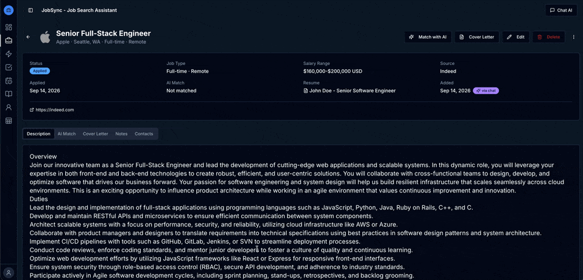

# JobSync

<p align="center"><strong>The self-hosted job search assistant with AI-powered resume review, job matching, and automated discovery</strong></p>

<p align="center">
  <a href="https://demo.jobsync.ca">Live Demo</a> ·
  <a href="#quick-start">Quick Start</a> ·
  <a href="#ai-assistant-in-app-chat">AI Assistant</a> ·
  <a href="#mcp-server-ai-agent-integration">MCP Setup</a> ·
  <a href="https://github.com/Gsync/jobsync/wiki">Help</a>
</p>

<p align="center">
  <a href="https://github.com/Gsync/jobsync/releases/latest"></a>
  <a href="./LICENSE"></a>
  <a href="https://github.com/Gsync/jobsync/stargazers"></a>
  
</p>

Track every application, get AI resume reviews and job matches, and discover new openings automatically — **free, open source, and your data never leaves your server.**

🔒 Self-hosted · 🤖 Local AI via Ollama or any cloud provider · 🔌 MCP server for Claude Desktop, Hermes, etc




⭐ If JobSync helps your search, a star helps other job seekers find it.

## Why JobSync?

- **One place for your whole search:** applications, resumes, contacts, interviews, tasks and AI help in a single source of truth, instead of scattered spreadsheets, notes and tabs.
- **Free forever:** no subscription and no paywalled tiers.
- **Private:** self-hosted, so your resumes and applications stay on your own server.
- **Local AI, no API costs:** run models on your own machine with Ollama, or bring a cloud provider key.

## Key Features

- **Application Tracker:** Record every application with its company, title, dates and current status.

  

- **Monitoring Dashboard:** See your search progress, activity and daily goals at a glance.
- **Resume Management:** Store resumes, export them as PDFs, and import existing PDF or Word files with AI.
- **Automated Job Discovery:** Schedule searches over company job boards and AI-match each listing to your resume. [Details](#automated-job-discovery)
- **Task & Activity Management:** Track tasks and time your activities. [Tasks](https://github.com/Gsync/jobsync/wiki/Tasks) · [Activities](https://github.com/Gsync/jobsync/wiki/Activities)
- **Contacts:** Keep recruiters, interviewers and references, linked to the jobs they touched. [Details](https://github.com/Gsync/jobsync/wiki/Contacts)
- **Company Pages:** One page per company with its jobs, people and links, plus a watchlist. [Details](https://github.com/Gsync/jobsync/wiki/Companies)
- **Question Bank:** Build a library of interview questions and answers, tagged by skill.
- **Data Backup & Restore:** Export everything as one zip, import it anywhere, and undo an import. [Details](https://github.com/Gsync/jobsync/wiki/Data-Backup)
- **AI Assistant:** A docked chat that reviews resumes, scores job matches, writes cover letters and adds jobs you paste in. [Details](#ai-assistant-in-app-chat)
- **AI Agent Integration (MCP):** Add jobs and questions from Claude Desktop and other agents. [Details](#mcp-server-ai-agent-integration)

## Quick Start

Make sure [Docker](https://www.docker.com) is installed and running, then:

```sh
git clone https://github.com/Gsync/jobsync.git
cd jobsync
docker compose up
```

> **Note:** The first startup downloads the prebuilt app image, so give it a moment before opening the browser.

Open [http://localhost:3737](http://localhost:3737) and create your account. That's it!

API keys for AI providers can be configured in **Settings** after signing in.

### Configuration (Optional)

Environment variables can be set in `docker-compose.yml`:

| Variable | Description |
|---|---|
| `TZ` | Your timezone (e.g. `America/Edmonton`). **Set this on remote servers** to avoid activity time shifts. |
| `AUTH_SECRET` | Auto-generated if not set. To set manually: `openssl rand -base64 32` |
| `ENCRYPTION_KEY` | Encrypts the API keys you save in Settings. **Set your own** (`openssl rand -base64 32`) before adding any keys, and never change it afterwards — a new value makes every stored API key unrecoverable. |
| `NEXTAUTH_URL` | The address you open JobSync at. Defaults to `http://localhost:3737`; on a homelab server, use the server's IP or hostname. |
| `MCP_ENABLED` | Set to `false` to turn off the [MCP server](#mcp-server-ai-agent-integration). Enabled by default in `docker-compose.yml`. |

### Updating

From the project directory, run the deploy script to pull the latest image and restart:

```sh
curl -fsSL https://raw.githubusercontent.com/Gsync/jobsync/main/deploy.sh | sudo bash -s
```

On **Windows**, run the PowerShell equivalent from the project directory instead (`deploy.sh` needs WSL or Git Bash; `deploy.ps1` runs natively):

```powershell
.\deploy.ps1
```

>Note: If you are updating in a homelab environment, edit `NEXTAUTH_URL` in your `.env` file to use your server IP address instead of `localhost`. See `.env.example` for the expected format.

## Features in Detail

### AI Assistant (In-App Chat)

All of JobSync's AI features live in one place: a chat panel that docks to the side of the app instead of taking it over, so the page you were on stays visible and usable while the assistant works.

Open it from the **AI Assistant** button in the header, or let the app open it for you — the **Review** button on a resume and the **Match with AI** and **Cover Letter** buttons on a job all start the matching request in the panel.

What you can ask for:

- **Resume review** — a full review of any of your resumes, with scores and written feedback, saved to the resume so you can come back to it.
- **Job match** — how well one of your resumes fits the job you're currently viewing, with a match score, a recommendation, and a write-up, saved to the job. Open the job first; the assistant scores the job on the page.
- **Cover letter** — a tailored letter for the job you're viewing, written from your resume and the job description (and any guidance from an earlier match), saved to your documents. Ask again and you get a new letter rather than losing the old one.
- **Add a job from a posting** — paste a job posting into the chat and ask it to add the job. It picks out the company, title, location, salary, tags and the rest, and shows you all of it on a confirmation card before anything is written. The description is saved exactly as you pasted it, not as a summary. Nothing reaches your database until you press Confirm.

The reviews, matches and letters are the same analyses the dedicated panels used to produce — the chat is a new way in, not a lighter-weight version.

The assistant is deliberately narrow about what it can see: it reads your resumes and the single job you're looking at, and nothing else. It can't list or search your jobs, and it can't see tasks or activities. Pasted postings are also treated as untrusted text, so instructions hidden inside a posting can't make the assistant act on your data.

Pick a model under **Settings > AI Settings** before using the panel — it needs one that supports tool calling, and it will tell you rather than guessing if none is set. See [known-good models](#supported-ai-model-providers) for the ones that have been tested, including a fully local option.

### PDF Resume Export

Export any resume as a professionally formatted PDF directly from the resume page. Choose between two layouts — a clean **Simple** template and a more polished **Professional** template. If a PDF attachment already exists, you'll be prompted to replace it or keep the download only.

### Resume Import

Import an existing resume from a PDF or Word (.docx) file. AI extracts structured data — contact info, summary, skills, work experience, education, and certifications — and presents each section as a review card. You can accept or skip individual sections before saving them to your resume.

### Automated Job Discovery

Set up automations that search for new jobs on a schedule and AI-match them against your resume, so relevant openings come to you.

- **Greenhouse** — track specific companies by name from a built-in directory (or by pasting a board URL). Each run pulls every published role from those companies' Greenhouse boards, ranks them against your target titles, skills, and resume with a fast local relevance score, and runs the AI match on only the top candidates to keep costs bounded. No API key required.

- **Lever** — same company-tracking workflow as Greenhouse, backed by a built-in directory of 1,160+ companies (or paste a board URL). Automatically resolves the right regional API (`lever.co` or `eu.lever.co`) per company and carries full remote/hybrid/onsite signal from the listing. No API key required.

- **Ashby** — same company-tracking workflow, backed by a built-in directory of 1,860+ companies (or paste a board URL). No API key required.

More job board sources are on the way. Discovered jobs are surfaced for review — accept the ones you like to promote them into your job tracker, or dismiss the rest.

### MCP Server (AI Agent Integration)

JobSync exposes an MCP server so AI agents (Claude Desktop, Hermes, OpenClaw, etc.) can add job applications and Question Bank entries directly, with your approval.

#### Use Case

Browsing a job posting or reading an interview question elsewhere and don't want to break your flow to log it manually? Just ask your connected AI agent, for example:

- *"Add this job to JobSync (copy/paste the complete job details or try providing a link): Senior Backend Engineer at Acme Corp, JobType, location, Job description... "*
- *"I just got asked this in an interview — add it to my Question Bank: 'How would you design a rate limiter?' with my answer: ..."*

The agent resolves or creates the company, title, location, and tags by name, and reports back what it matched versus created — so your data stays de-duplicated without you having to switch to the app.

When you add a job with a substantial description and you've set a **default resume** (Profile), the agent also analyzes the fit against that resume and saves a job match score — no round trip to the app needed. The result shows up on the job just like an in-app AI match, scores, recommendation, and write-up included.

#### 1. Generate a token

1. Sign in to JobSync and go to **Settings > MCP Access**.
2. Click **Generate**, give it a name (e.g. the client you'll connect, like "Claude Desktop"), and pick an expiry.
3. Copy the token and config snippets shown — the full token is only displayed once.

#### 2. Add it to your MCP client

<details>
<summary><strong>Claude Desktop</strong></summary>

1. Open Claude Desktop → **Settings > Developer > Edit Config**. This opens `claude_desktop_config.json` in your default editor.
2. Paste the "Claude Desktop (via mcp-remote)" snippet from the reveal dialog into `mcpServers`, e.g.:

```json
{
  "mcpServers": {
    "jobsync": {
      "command": "npx",
      "args": [
        "mcp-remote",
        "http://<your-jobsync-url>/api/mcp",
        "--header",
        "Authorization: Bearer <your-token>"
      ]
    }
  }
}
```

3. Save and fully restart Claude Desktop (quit, not just close the window).

> **Note:** Claude Desktop only supports local (stdio) MCP servers directly, so `mcp-remote` is required as a bridge to JobSync's remote endpoint.

</details>

<details>
<summary><strong>Other clients (OpenClaw, Hermes, etc.)</strong></summary>

Clients that support `streamable-http` natively can connect directly without `mcp-remote`:

```json
{
  "mcpServers": {
    "jobsync": {
      "type": "streamable-http",
      "url": "http://<your-jobsync-url>/api/mcp",
      "headers": { "Authorization": "Bearer <your-token>" }
    }
  }
}
```

</details>

> **Self-hosting on a home network?** If your JobSync URL is a plain `http://` LAN address (not `localhost` or HTTPS), add `--allow-http` to the `mcp-remote` args — it refuses non-HTTPS URLs by default. The Settings page adds this flag automatically when it detects a non-localhost HTTP URL.


## Help

In-app usage guides — getting started, jobs, automations, and MCP access — live in the [GitHub Wiki](https://github.com/Gsync/jobsync/wiki).

## Contributing

We welcome contributions! Please read our [Contributing Guidelines](./CONTRIBUTING.md) to get started. This project follows a [Code of Conduct](./CODE_OF_CONDUCT.md) — by participating, you agree to uphold its standards.

### Credits

- <a href="https://github.com/facebook/react">React</a>
- <a href="https://github.com/vercel/next.js">Next</a>
- <a href="https://github.com/shadcn-ui/ui">Shadcn</a>
- <a href="https://github.com/prisma/prisma">Prisma</a>
- <a href="https://github.com/tailwindlabs/tailwindcss">Tailwind</a>
- <a href="https://github.com/ueberdosis/tiptap">Tiptap</a>
- <a href="https://github.com/plouc/nivo">Nivo</a>
- <a href="https://github.com/sqlite/sqlite">Sqlite</a>
- <a href="https://github.com/vercel/ai">Vercel AI-SDK</a>
- <a href="https://github.com/ollama/ollama">Ollama</a>

### Supported AI Model Providers

API keys for all cloud providers can be configured in **Settings > AI Settings** after signing in. Ollama is selected as the default provider.

> **Note:** Selected models must support **structured output** and **tool calling** for AI features to work correctly — the AI Assistant panel works by calling tools, so a model without tool support will reply with text instead of doing anything.

**Known-good models.** The AI Assistant has been tested end to end with `qwen3.5:9b` on Ollama (fully local), `deepseek-v4-flash`, and OpenAI `gpt-4.1`. Other tool-calling models should work, but these are the ones exercised against the full set of assistant features.

<details>
<summary><strong>Ollama (Local)</strong></summary>

Works with [Ollama](https://ollama.com) to run AI models locally on your machine.

- Make sure Ollama is installed and running on the same system
- AI settings will show a list of available models based on what you have downloaded in Ollama
- **Recommended:** Increase the Ollama context length from the default 4k to 16k — this helps automated job matching avoid truncating longer resume/job description prompts. The AI Assistant, resume review, job match and cover letter features aren't affected: they ask Ollama for the context size they need on every call, so raising this setting won't change them. Don't raise it much further either — a very large default costs you noticeably slower responses for no benefit
- No API key required — runs entirely on your hardware
- If you are running jobsync on a homelab server, you can expose ollama to network from Ollama settings on your local machine. Also make sure your ollama base url is pointed to your local system IP under API keys section of settings.

</details>

<details>
<summary><strong>OpenAI</strong></summary>

- Get your API key at [platform.openai.com/api-keys](https://platform.openai.com/api-keys)
- Add your API key in **Settings > AI Settings**
- Select **OpenAI** as the provider and choose your preferred model
- Available models are fetched dynamically from the OpenAI API

</details>

<details>
<summary><strong>DeepSeek</strong></summary>

- Get your API key at [platform.deepseek.com/api_keys](https://platform.deepseek.com/api_keys)
- Add your API key in **Settings > AI Settings**
- Select **DeepSeek** as the provider and choose your preferred model

</details>

<details>
<summary><strong>Google Gemini</strong></summary>

- Get your API key at [aistudio.google.com/apikey](https://aistudio.google.com/apikey)
- Add your API key in **Settings > AI Settings**
- Select **Gemini** as the provider and choose your preferred model

</details>

<details>
<summary><strong>OpenRouter</strong></summary>

Access a wide range of AI models from multiple providers through a single API.

- Get your API key at [openrouter.ai/keys](https://openrouter.ai/keys)
- Add your API key in **Settings > AI Settings**
- Select **OpenRouter** as the provider and choose from available models

</details>

### Note

- If you are updating from an old version and already logged in, please try logging out and login again.

## Support the Project

If JobSync has been helpful in your job search, consider giving it a star on GitHub! It helps others discover the project and motivates continued development.

Every star means a lot — thank you for your support!

